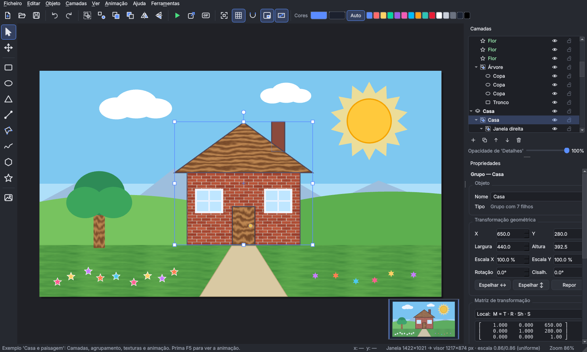

# Editor Gráfico e Modelador Geométrico

Trabalho Prático Final de **Computação Gráfica** — **Grupo 5**.
Editor gráfico 2D para criar, modificar e manipular objetos geométricos em tempo real,
feito em **Python + OpenGL** (PyOpenGL), com interface em **Qt** (PySide6).



---

## 1. Correr o editor

### Opção A — Executável (não precisa de Python)

`EditorGeometrico.exe` é um único ficheiro: basta fazer duplo clique.
É criado automaticamente pelo GitHub Actions em cada *push* (separador **Actions** →
execução mais recente → **Artifacts**) ou localmente com `build_exe.bat` (ver secção 4).

### Opção B — A partir do código (para o grupo)

**Windows** (duplo clique nos ficheiros, pela ordem):

1. `setup.bat` — encontra o Python (3.10 a 3.14; recomendado **3.12**), cria o ambiente
   virtual `.venv`, instala as bibliotecas com as versões fixas e corre um **autoteste**.
2. `run.bat` — abre o editor.

**Linux / macOS**: `./setup.sh` e depois `./run.sh`.

> **Porque é que o Python "não parte":** todas as bibliotecas ficam dentro da pasta `.venv`
> do projeto, com as versões fixadas em `requirements.txt`. Nada é instalado no Python do
> computador, por isso não há conflitos com outros trabalhos. Se algo correr mal, apague a
> pasta `.venv` e volte a correr `setup.bat`. A pasta `.venv` **nunca** vai para o Git nem para o ZIP.

Se o computador tiver um driver gráfico fraco (janela preta ou erro de OpenGL), use
`run.bat --software-gl` (ou `EditorGeometrico.exe --software-gl`). O editor também deteta
o problema sozinho e pergunta se deve reiniciar neste modo.

Ao abrir o `.exe` pela primeira vez, o Windows SmartScreen pode avisar que a aplicação não é
reconhecida (o executável não tem assinatura digital): clique em **Mais informações →
Executar mesmo assim**. O arranque demora alguns segundos, porque o `.exe` se descompacta.

## 2. Funcionalidades

| Requisito do enunciado | Como está no editor |
|---|---|
| Criação de formas | Retângulo, elipse, triângulo, linha, polígono livre, mão livre, polígono regular, estrela, imagem |
| Translação · Rotação · Escala | Arrastar, alças (Shift proporcional, Alt a partir do centro), teclado, valores numéricos; também cisalhamento e espelho |
| Alteração dinâmica de cores | Seletor com pré-visualização ao vivo, paleta rápida, opacidade, ciclo de cor animado |
| Agrupamento de objetos | Agrupar/desagrupar (Ctrl+G / Ctrl+Shift+G), grupos dentro de grupos, entrar no grupo com duplo clique |
| Sistema de camadas | Criar, duplicar, apagar, reordenar, mostrar/ocultar, bloquear, opacidade, mover objetos entre camadas |
| Salvar / carregar projetos | Ficheiro `.geo` (JSON) com as imagens embutidas; abrir recente; arrastar ficheiros para a janela |
| Exportação de imagem | PNG/JPG/BMP em qualquer resolução (render fora do ecrã), fundo transparente; **GIF animado** |
| Interface gráfica funcional | Menus, barras de ferramentas, painéis Camadas e Propriedades, barra de estado, menu de contexto |
| Objetos animados | Rodar, pulsar, oscilar e ciclo de cor por objeto (F5); ecrã inicial animado |
| Texturas | 8 texturas geradas por código (repetíveis) + imagens importadas como textura, com repetição |
| Imagens digitais / manipulação | Importar PNG/JPG; filtros: cinzento, negativo, sépia, brilho, contraste, desfocar, nitidez, espelhar |
| Janela-visor sem distorção | Escala sempre igual em x e y; modo de demonstração **com** distorção para comparar |
| Viewport | Minimapa como segundo visor (`glViewport`), clicável |
| Múltiplas cenas / menus | Ecrã inicial → Editor → Ajuda, mais menus e menus de contexto |
| Teclado e mouse | Atalhos para tudo (F1 mostra a lista completa) |
| Estrutura modular | Pacotes `core` / `render` / `tools` / `ui` (ver `docs/ARQUITETURA.md`) |
| Extras | Desfazer/refazer (100 passos), inspetor de matrizes ao vivo, grelha com ajuste, exemplos, `.exe` |

## 3. Estrutura do código

```
main.py                 ponto de entrada
editor/
  core/                 modelo e matemática (sem Qt nem OpenGL — testável sozinho)
    matrix.py           Mat3 homogénea, T/R/S/Sh, inversa, decomposição
    geometry.py         primitivas, ear clipping, ponto-no-polígono, Ramer–Douglas–Peucker
    shapes.py           formas e grupos (modelação hierárquica)
    document.py         documento, prancheta e camadas
    operations.py       agrupar, ordenar, apagar, duplicar, espelhar…
    history.py          desfazer/refazer por instantâneos
    fileio.py           guardar/carregar .geo
    animation.py        transformações em função do tempo
    picking.py          seleção com a matriz inversa
    examples.py         projetos de exemplo
  render/               OpenGL
    renderer.py         desenho (glMultMatrixf, arrays de vértices, texturas)
    camera.py           transformação janela → visor sem distorção
    tessellation.py     malhas de preenchimento e contornos
    textures.py         texturas procedurais, filtros, cache de texturas
    exporter.py         PNG/JPG e GIF via framebuffer (FBO)
  tools/                ferramentas (seleção, formas, polígono, mão livre, mão)
  ui/                   janela, canvas OpenGL, painéis, ecrã inicial, ajuda
  controller.py         estado da aplicação e comandos (liga o modelo à interface)
  selftest.py           autoteste sem janelas
tests/                  testes do núcleo (python -m unittest)
docs/                   manual do utilizador (.docx), decisões técnicas e arquitetura
```

## 4. Criar o executável

- **No Windows:** duplo clique em `build_exe.bat` → `dist\EditorGeometrico.exe` (≈ 80–100 MB,
  um só ficheiro). O script corre o autoteste dentro do `.exe` no fim.
- **No GitHub:** cada *push* corre `.github/workflows/build-windows.yml`, que testa o código,
  cria o `.exe`, corre o autoteste com OpenGL por software e guarda o `.exe` em **Artifacts**.
  Criar uma tag (`git tag v1.0` e `git push --tags`) publica o `.exe` numa *Release*.

> O `.exe` é demasiado grande para anexar ao email. Para o docente, envie o link da
> *Release* (ou do Google Drive) e ponha no ZIP apenas o código.

## 5. Testes

```
.venv\Scripts\python -m unittest discover -s tests -v     (Windows)
.venv\Scripts\python main.py --selftest autoteste         (gera imagens e um GIF em autoteste\)
```

## 6. Entrega (enunciado)

Prazo: **10/11/2026 até às 23h30**, por email ao docente.
Relatório técnico em PDF (13 secções) · código-fonte · ficheiro `.zip` · vídeo de 3 a 5 minutos.

- **Manual do utilizador:** `docs/Manual_do_Utilizador.docx` (Word; em *Ficheiro → Guardar como* dá PDF).
- **Vídeo de demonstração:** `entrega/Video_Demonstracao_Editor_Geometrico.mp4` (3 min 17 s, sem som, com
  legendas). Fica fora do Git por ser grande: partilhe-o por link, como o `.exe`.

Para o ZIP do código: `git archive -o Grupo5_EditorGeometrico.zip HEAD` (inclui só o que está no
Git — sem `.venv`, `build` nem `dist`).


# Comandos Uteis
O PowerShell (que é o terminal do VS Code) só corre scripts da pasta atual se tiverem .\ à frente. Basta escrever:

Rodar no powershell:
.\setup.bat

Só precisas de fazer isto uma vez. Na primeira vez demora uns minutos, porque descarrega cerca de 100 MB de bibliotecas para a pasta .venv. No fim corre o autoteste e deve aparecer “Pronto!”.

## 1) Mais simples: usar diretamente o Python do ambiente
.\.venv\Scripts\python.exe main.py

## 2) Ou ativar o ambiente (aparece "(.venv)" no início da linha) e usar "python" normalmente
.\.venv\Scripts\Activate.ps1
python main.py

## Comandos úteis (com o ambiente ativado):
python main.py                                 # abrir o editor
python main.py --software-gl                   # se a janela ficar preta ou der erro de OpenGL
python -m unittest discover -s tests -v        # testes do núcleo
python main.py --selftest autoteste            # autoteste: gera imagens e um GIF em autoteste\