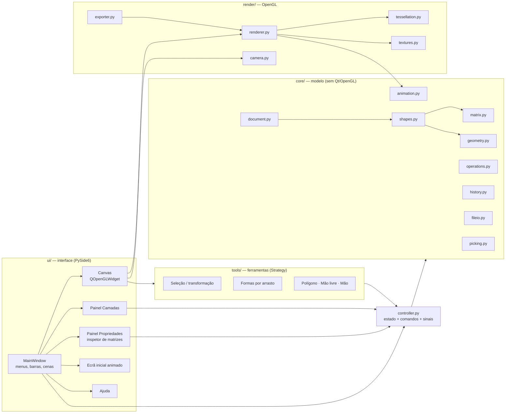
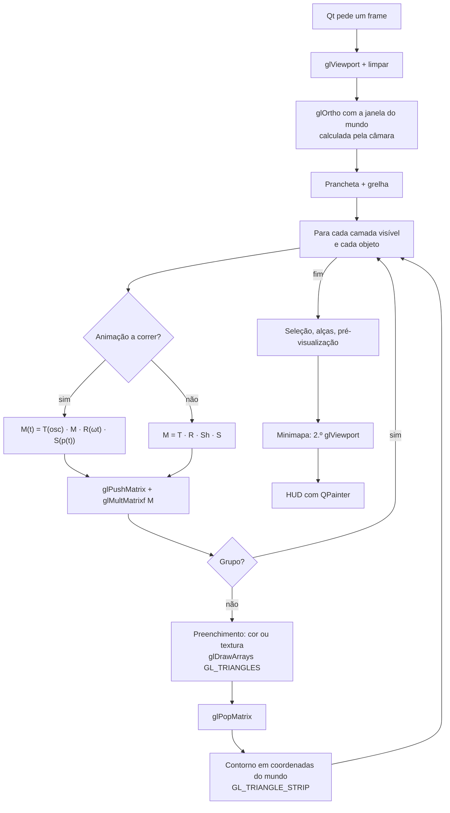
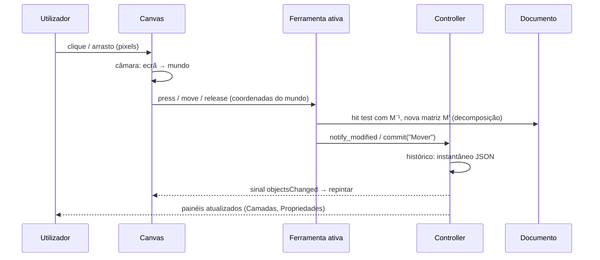

# Arquitetura do sistema

Diagramas para a secção 9 do relatório ("Fluxograma ou diagrama do sistema"). Os blocos
`mermaid` aparecem desenhados no GitHub; para o relatório, abra-os em https://mermaid.live e
exporte como PNG.

## Módulos

## Ciclo de desenho (paintGL)

## Interação (do clique à alteração)

